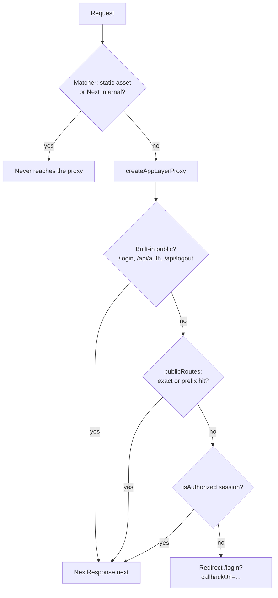

# Design: App-layer proxy factory API

## GitHub Issue

_Pending — "Replace the copied middleware matcher with a proxy factory API". Fill in the issue
number once it is created._

Related: #17 (Playwright E2E harness) depends on this spec and should land afterwards.

## Summary

Every app consuming this library has to copy a ~140-character regex into its own `middleware.ts`
by hand, because Next.js requires `config.matcher` to be a static literal in that exact file. Five
apps carry that copy today (`open-crm`, `open-tasks`, `open-transcript`, `bewirtung`,
`application-skeleton`), and `open-transcript` has already extended its copy with four additional
routes — so the copies have begun to diverge in production.

The regex mixes two concerns with very different lifetimes: Next.js internals and asset extensions
(stable since Next 12) and app routes (`api/auth`, `api/logout`, `login`, plus app-specific
additions). The volatile half is what forces apps to edit the regex, and editing is what can damage
the stable half — silently, because Next.js does not report a broken matcher.

This spec splits the matcher by volatility. The stable half stays a documented literal that apps
copy once and never touch. The volatile half becomes an API: a `createAppLayerProxy` factory that
filters public routes at request time. `middlewareConfig` is removed in the same release.

## Goals

- Remove all app-specific routes from the regex that consuming apps copy.
- Make the route-classification logic a pure, unit-testable function inside the library.
- Name the new API for the Next.js 16 `proxy` convention, so consumers rename once rather than twice.
- Keep the backend proxy routes (`/api/*` other than auth/logout) auth-gated, as they are today.
- Replace the string-copy guard problem with behavioural matcher tests using Next.js' own
  `unstable_doesMiddlewareMatch`.

## Non-goals

- The Playwright E2E harness (#17). It lands on top of this.
- Migrating the five consuming apps. Each gets its own PR in its own repo, driven by the upgrade guide.
- Renaming consumers' files from `middleware.ts` to `proxy.ts`. That follows the Next.js 16 upgrade
  (tracked in `docs/TODO.md`).
- Raising the `next` peer dependency to 16.
- Making the login page honour `callbackUrl`. This spec only ensures the parameter is produced.

## Background: why the copy cannot be avoided, and why it fails silently

Next.js reads the matcher by parsing the AST of the middleware file itself:

```js
// next/dist/build/analysis/get-page-static-info.js
try {
  exportedConfig.config = extractExportedConstValue(ast, 'config');
} catch (e) {
  if (e instanceof UnsupportedValueError) { warnAboutUnsupportedValue(pageFilePath, page, e); }
  // `export config` doesn't exist, or other unknown error thrown by swc, silence them
}
```

A re-export means there is no `const config` declaration in that file, the lookup throws, and
Next.js — by its own comment — silences it. The build then falls back to a catch-all:

```js
// next/dist/build/webpack/plugins/middleware-plugin.js
const matchers = metadata?.edgeMiddleware?.matchers ?? [
  { regexp: namedRegex, originalSource: page === '/' && catchAll ? '/:path*' : matcherSource }
];
```

The result is no error, no warning, and middleware running on every request including
`_next/static` — the deployment breakage the current doc comment in `src/server/middleware.ts`
describes. The Next.js docs state the constraint directly: *"The `matcher` values need to be
constants so they can be statically analyzed at build-time. Dynamic values such as variables will
be ignored."*

**This is why no export can fix the problem.** Exporting a constant named `proxyMatcher` would not
help: `export const config = { matcher: proxyMatcher }` is still not a literal and still fails
silently. Only a copied literal works — which is why this design keeps a literal and shrinks it to
the half that never changes, rather than trying to eliminate it.

## Technical approach

### What moves where

| Concern | Today | After |
|---|---|---|
| `_next/static`, `_next/image`, `favicon.ico`, `.svg`/`.png`/`.jpg`/`.ico` | copied regex | copied regex (unchanged half) |
| `/api/auth`, `/api/logout`, `/login` | copied regex | library, at request time |
| App-specific public routes | copied regex, hand-edited | `publicRoutes` option |
| Authorization check | `authorized` callback | `isAuthorized`, called by the proxy |

The matcher consuming apps copy becomes:

```ts
export const config = {
  matcher: ["/((?!_next/static|_next/image|favicon\\.ico|.*\\.svg$|.*\\.png$|.*\\.jpg$|.*\\.ico$).*)"],
};
```

Note what is deliberately **not** excluded: `/api` as a whole. The Next.js and Auth.js documented
examples both exclude `api`, but this library's `createBackendProxyHandler` is mounted under
`/api/*` and must stay auth-gated. Only `/api/auth` and `/api/logout` are public, and they are now
handled at request time rather than in the regex.

### API

```ts
// src/server/proxy.ts

export interface AppLayerPublicRoutes {
  /** Paths that bypass the auth check when the pathname equals them exactly. */
  readonly exact?: readonly string[];
  /** Paths that bypass the auth check when the pathname equals them or starts with them + "/". */
  readonly prefix?: readonly string[];
}

export interface AppLayerProxyOptions {
  readonly publicRoutes?: AppLayerPublicRoutes;
}

export function createAppLayerProxy(
  auth: NextAuthResult["auth"],
  options?: AppLayerProxyOptions,
): NextMiddleware;
```

`auth` is the value returned by `createAppLayerAuth`. Its middleware overload
(`(...args: [NextAuthMiddleware]) => NextMiddleware`, verified in next-auth 5.0.0-beta.30) is what
the factory wraps.

**Rationale for offering both `exact` and `prefix`:** the real cases need both. `open-transcript`
has `/record-e2e`, which has sub-pages and therefore wants prefix semantics, alongside `/sw.js`,
`/manifest.webmanifest` and `/offline`, which are single resources where a prefix match would be
needlessly broad. A single mode would force every consumer into the wrong one for half its routes.

**Built-in public routes**, always applied and not configurable: `/api/auth`, `/api/logout` and
`/login`, all with prefix semantics. These are the routes the auth flow itself needs; making them
configurable would only allow apps to break their own login.

### Prefix semantics

A prefix entry `p` matches when `pathname === p || pathname.startsWith(p + "/")`. The explicit
`"/"` boundary is what stops `/offlinexyz` from matching `/offline`. Configured prefixes have a
trailing slash stripped during normalisation, so `/offline` and `/offline/` behave identically.

### Validation

The factory validates its options once, when it is called (module evaluation, i.e. build or server
start) and throws on:

- an entry that does not start with `/`,
- `"/"` as a `prefix` entry, which would make every route public.

Failing at startup rather than per request makes a misconfiguration loud and immediate, which is the
property this whole change is about.

### Authorization and redirect

The proxy reuses the existing `isAuthorized` predicate from `src/server/oidc-tokens.ts` (checks
`session.user` and `session.error !== "RefreshTokenError"`), so the proxy and the `authorized`
callback cannot drift apart.

On an unauthorized request it redirects to `/login` with a `callbackUrl` query parameter carrying
the originally requested path. The parameter is a **relative** `pathname + search`, never an
absolute URL, so that a future consumer honouring it cannot be turned into an open redirect.

`LoginClient` currently ignores `callbackUrl` and redirects to its configured `homeRoute` after
login, so this changes nothing user-visible today. It is produced so that honouring deep links
later is a login-page change only, not another proxy change.

### Key flow



### Testing

Two layers, both in Vitest, neither needing a browser:

1. **Route classification** — `isPublicRoute` is a pure function, exported from `src/server/proxy.ts`
   for tests (not re-exported from `src/server.ts`, matching how `oidc-tokens` internals are tested
   today).
2. **Matcher behaviour** — using `unstable_doesMiddlewareMatch` from
   `next/experimental/testing/server`, which is present in the installed Next 15.5.18 alongside
   `unstable_getResponseFromNextConfig`, `isRewrite`, `getRewrittenUrl` and `getRedirectUrl`. This
   asserts behaviour (`/` matches, `/_next/static/*` does not) rather than string equality, which is
   strictly better than the guard test the copied string would otherwise need.

## Breaking change

`middlewareConfig` is removed rather than deprecated. It is a plain string constant, so removal
surfaces as a TypeScript compile error in consumers — loud, immediate and trivially fixed. Keeping
it would preserve exactly the silent misconfiguration this change exists to eliminate, and would
cost consumers two migrations instead of one. The library is at 0.9.0, where breaking changes in a
minor are established practice (upgrade guides exist for 0.6, 0.7.1, 0.8 and 0.9).

An AI-executable upgrade guide under `docs/releases/` covers the migration.

## Dependencies

- `next-auth` 5.0.0-beta.30 — the `auth(callback) => NextMiddleware` overload.
- `next` ^15.3.0 — `NextResponse`, `NextMiddleware`; `next/experimental/testing/server` for tests
  (available since 15.1).
- Internal: `isAuthorized` from `src/server/oidc-tokens.ts`.

## Security considerations

- **Fail closed.** Any path that is neither a built-in public route nor a configured `publicRoutes`
  entry requires a session. A malformed or unmatched path is protected, not public.
- **No open redirect.** `callbackUrl` is a relative path, never an absolute URL.
- **`/api/*` stays gated.** The coarse matcher deliberately does not exclude `/api`, so the backend
  proxy remains behind auth.
- **Proxy is not the only gate.** Both Next.js and Auth.js warn against relying on it exclusively —
  Auth.js: *"You should not rely on the proxy exclusively for authorization. Always ensure that the
  session is verified as close to your data fetching as possible."* The README should repeat this.
- **Validation throws early**, so a typo in `publicRoutes` cannot silently widen the public surface.

## Open questions

- Should the coarse matcher also exclude `robots.txt` and `sitemap.xml`? They sit in `public/` and
  are redirected to `/login` today, which is arguably a bug — crawlers cannot read them. Adding them
  changes behaviour for all five apps, so it is listed here rather than assumed.
- Should the `authorized` callback stay in `createAppLayerAuth`? The `auth(callback)` form does not
  consult it, so it becomes dead code for anyone using the new proxy. It is harmless to keep and
  removing it is a second breaking change; the recommendation is to keep it and document that the
  proxy applies the same `isAuthorized` predicate.

---

## Drift Log

### 2026-11-23 — Caused by spec `003-public-crawler-files`

- **Affected element:** the canonical coarse matcher published for consumers to copy
- **Original design:** listed under *Open questions* as undecided — the matcher excluded Next.js
  internals and asset extensions only, so `/robots.txt` and `/sitemap.xml` were answered with a
  redirect to `/login`
- **Current state:** the matcher additionally excludes `robots\.txt` and `sitemap\.xml`, so both are
  publicly readable. The exclusion is anchored at the site root; `/reports/robots.txt` and other
  `.txt`/`.xml` routes stay protected.
- **Reason:** spec 003 resolved this spec's first open question. It was deliberately left open here
  because changing the matcher changes behaviour for all five consuming apps, which warranted its
  own decision. 0.10.0 was still unreleased when 003 landed, so consumers see one matcher, not two.
