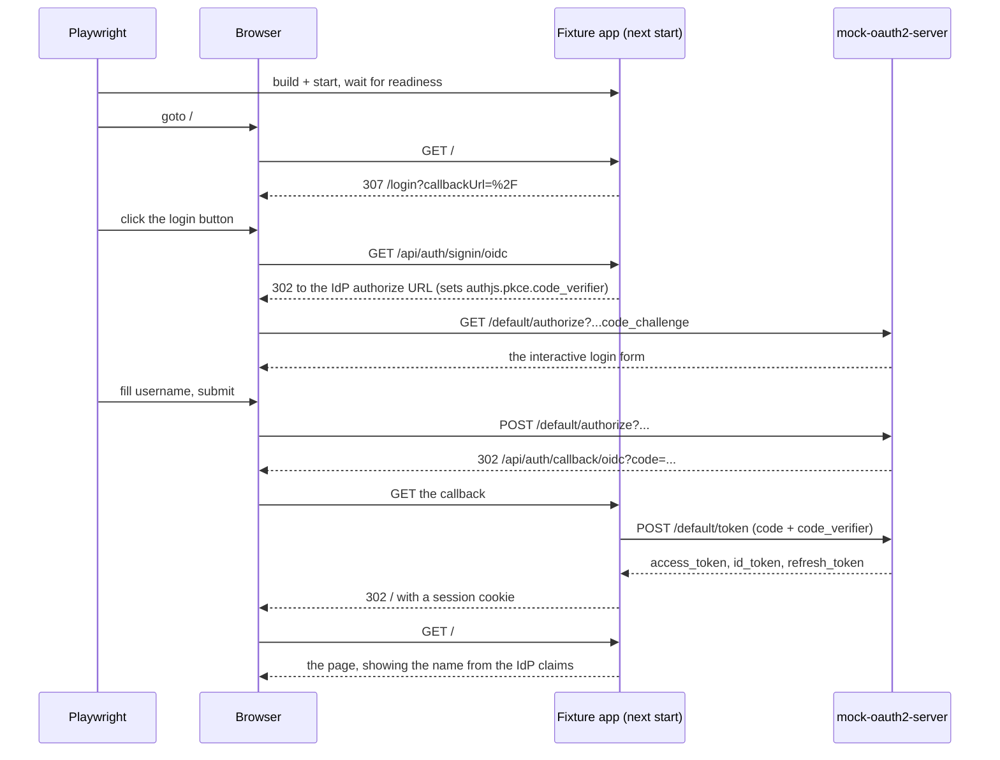

# Design: Playwright E2E harness

## GitHub Issue

[#17 — Add Playwright E2E test harness with fixture app and mock OIDC server](https://github.com/OpenElementsLabs/nextjs-app-layer/issues/17)

Builds on spec [`002-app-layer-proxy-api`](../002-app-layer-proxy-api/design.md). Unblocks #16 and
the logout and token-refresh E2E issues; see [`docs/roadmap.md`](../../roadmap.md).

## Summary

This repository has only Vitest unit tests. There is no running app, no identity provider and no
browser, so the flows that depend on all three — login, callback handling, proxy redirects, logout
and token refresh — cannot be tested here at all. Defects in them surface later, in consuming apps.
#16 is a concrete instance: an interrupted login ends on the Auth.js error page, and nothing in this
repo could have caught it.

This spec adds the harness: a minimal Next.js fixture app that wires the library the way consumers
do, a mock OIDC server in Docker, a Playwright configuration with three browser projects, shared
helpers, two smoke tests and a CI job. The two tests are proof of life — the deliverable is the
harness, and its value is that every further flow becomes one spec file.

## Goals

- Run the library's auth flow against a real OIDC server in a real browser, in CI and locally.
- Consume the library from this repo's build, never from npm, so the tests exercise the PR's code.
- Keep `e2e/` out of the published package, the library build and the unit-test run — while still
  type-checking and linting it, so the harness does not rot.
- Make adding the next flow a matter of writing a spec file.

## Non-goals

- Login error flows (#16), logout and token refresh — each lands on this harness afterwards.
- E2E coverage of the admin pages.
- WebKit. Can be added later; it costs a third browser download for a platform no OE app targets
  first.
- Changing any library source. The fixture app consumes the public API as-is.

## Verified facts

These were established by running `ghcr.io/navikt/mock-oauth2-server:3.0.1` locally and driving a
complete PKCE flow through it with `curl`. They are recorded because several contradict reasonable
guesses, and the implementation depends on them.

**The issuer is derived from the request's Host header.** The discovery document returned
`"issuer": "http://localhost:18888/default"` for a request to that port. This is the reason #17
requires one issuer URL for both the browser and the Next.js server: reaching the container over the
compose network (`http://mock-oauth2:8080/default`) would yield a *different* issuer string and the
token validation would fail. Both must therefore use the published host port.

**Config claims win over the typed username.** With `interactiveLogin: true`, the login form asks
for a username, but a matching `requestMapping`'s claims take priority — the upstream README states
that page-submitted claims "can add new claims but cannot overwrite claims already set by the
mapping". Confirmed: typing `typed-in-user` and matching on `grant_type=authorization_code` produced
`sub: "e2e-user"`, `name: "E2E User"`, `email: "e2e@example.test"`, `roles: ["APP-USER"]`. The two
parts of #17 that looked contradictory — an interactive form *and* asserting the name from the IdP
claims — are therefore consistent.

**The login form's exact markup**, which `loginViaIdp` needs:

```html
<form method="post">
  <input class="u-full-width" required type="text" name="username" placeholder="Enter any user/subject" autofocus="on">
  <textarea class="u-full-width claims" name="claims" rows="15" placeholder="Optional claims JSON value, …"></textarea>
  <input class="button-primary" type="submit" value="Sign-in">
</form>
```

The form has no `action`, so it posts back to the authorize URL with its query string intact.

**PKCE S256, refresh tokens and short expiries all work.** The flow returned `access_token`,
`id_token` and `refresh_token`, and `tokenExpiry: 20` produced `expires_in: 19`. The discovery
document exposes `end_session_endpoint`, so the logout issue is feasible on this image.

**Tag `3.0.1` exists** (digest `sha256:4f3660e5f358…`).

## Technical approach

### How the fixture app sees the library

The fixture app becomes a **pnpm workspace package** depending on the library with `workspace:*`.
`pnpm-workspace.yaml` gains its first `packages:` key, which makes this repo formally a monorepo and
adds a second importer to the lockfile.

**Rationale.** Measured against the two alternatives:

| | `link:` | `file:` | `workspace:*` |
|---|---|---|---|
| After `rm -rf dist` + rebuild | live | **serves the pre-rebuild state** | live |
| New file in `dist/` visible | yes | **no** | yes |
| peerDeps resolved | **no** | yes | yes |

`file:` hard-links individual files into the virtual store at install time. `prebuild` runs
`rm -rf dist` and `tsc` writes every file with a new inode, so the links point at deleted content —
measured: after a rebuild it served the previous build, and an added file was missing entirely. A
harness whose purpose is "tests the code in this PR" cannot be built on that.

`link:` is worse in a subtler way. Without `packages:` the fixture app is not part of the root
install, so it needs its own `node_modules`. The symlinked library resolves its imports from its
real path (Next.js follows symlinks), i.e. from the **root** tree, while the app's own code resolves
from the **fixture** tree — two physical React directories, two module instances. The library
exports `SessionProvider`, a React context, so that breaks. Measured additionally: with `link:`,
pnpm installs the linked package's peerDependencies not at all.

Under `workspace:*` both importers resolve to the same physical directory
(`node_modules/.pnpm/react@19.x/node_modules/react`), which is the property that matters.

`e2e/` is already excluded from the published tarball: `files: ["dist", "src"]` is an allowlist, and
`pnpm pack` was verified to contain only `dist`, `src`, `package.json`, `README.md`, `LICENSE`. The
fixture app additionally carries `"private": true`.

### Build ordering

The fixture app imports the library through its `exports` map, which points into `dist/`, and
`dist/` is gitignored. So `pnpm e2e` runs `pnpm run build` first. In CI the library is built by its
own step as well, which means it is built twice; accepted as the cost of not having a stale-`dist`
failure mode.

`reuseExistingServer` is **`false`**, not the usual `!process.env.CI`. A locally running `next start`
from an earlier run holds the previous library in memory, which the forced rebuild does not fix, so
reuse would reintroduce silently-green tests. Correctness over local iteration speed.

### The fixture app

```
e2e/fixture-app/
├── package.json          private, workspace:* on the library
├── next.config.ts
├── tsconfig.json
└── src/
    ├── auth.ts           createAppLayerAuth from env
    ├── middleware.ts     createAppLayerProxy(auth) + the coarse matcher literal
    └── app/
        ├── layout.tsx
        ├── page.tsx                      protected, renders session.user.name
        ├── login/page.tsx                createLoginPage({ appName: "E2E", homeRoute: "/" })
        └── api/auth/[...nextauth]/route.ts
```

Spec 002 simplified this part considerably: the middleware is now
`export default createAppLayerProxy(auth)` plus the documented matcher literal, and the question of
the fixture app's matcher drifting from a canonical one no longer exists — there is no exported
matcher to drift from, and the documented copies are already pinned by a test.

Configuration comes from env vars with local defaults: `AUTH_SECRET`, `AUTH_URL`, `OIDC_ISSUER`,
`OIDC_CLIENT_ID`, `OIDC_CLIENT_SECRET`.

**Naming note.** `open-transcript` and `open-crm` call the issuer variable `OIDC_ISSUER_URI`. #17
specifies `OIDC_ISSUER`. The divergence is parked in `docs/TODO.md`; this spec follows #17 so the
issue and the code agree, and converging the name is a separate, cross-repo change.

### Mock IdP

`e2e/docker-compose.yml` runs the pinned image with `e2e/mock-oauth2-config.json`, published on a
fixed host port. The same file is used locally and in CI.

The config uses `interactiveLogin: true` so the harness drives a real form submission — which is what
makes #16's scenarios (two tabs, replayed callback, missing pkce cookie) expressible later — and
`requestMappings` on `grant_type` for both `authorization_code` and `refresh_token`, carrying `sub`,
`name`, `email` and `roles`, mirroring `open-crm`'s config.

### Playwright

`playwright.config.ts` at the repo root, specs under `e2e/`. The `webServer` entry builds and starts
the fixture app and waits for readiness.

Three projects: `chromium`, `firefox`, and `firefox-hardened` — a Firefox profile with
LibreWolf-like `firefoxUserPrefs` (resist fingerprinting, strict tracking protection, first-party
isolation).

On the hardened profile: it is expected to pass. First-party isolation partitions cookies by
top-level site, but a redirect-based OIDC flow is itself the top-level site at each step, so it does
not cross that partition — FPI breaks third-party iframe and silent-renew flows, which this library
does not use. #16 names the actual LibreWolf mechanism: cookies deleted on exit while tabs are
restored, so a restored callback tab arrives without the PKCE cookie. If the hardened profile
nonetheless fails, that is a real product bug affecting real users and gets its own issue; the
profile is not weakened to make the suite green.

Settings adopted from the existing house setup in `open-transcript/frontend/playwright.config.ts`:
`workers: 1`, `fullyParallel: false`, `reporter: "list"`, `NEXT_TELEMETRY_DISABLED: "1"`, and a
generous `webServer.timeout` because the command includes a production build.

### Helpers — `e2e/helpers.ts`

- `loginViaIdp(page)` — go to `/login`, click the login button, fill `input[name="username"]` on the
  IdP form, submit it. One place to adjust if the upstream form changes, which is the reason it is a
  helper rather than inline steps.
- `expectNoAuthErrorPage(page)` — fail if the URL contains `/api/auth/error`. #16 uses it in every
  scenario, so it is introduced here.

### Scripts

`pnpm e2e:up` starts the IdP, `pnpm e2e` builds the library and runs the tests, `pnpm e2e:down`
stops the IdP. #17's naming is followed; `open-transcript` uses `test:e2e`, parked in
`docs/TODO.md`.

### Hygiene: `e2e/` is checked, not ignored

#17's criterion "nothing from `e2e/` ends up in the published package, the library build, lint or the
unit tests" is **already satisfied by construction** for three of the four: `files` is an allowlist,
`tsconfig.build.json` includes only `src/**`, and `vitest.config.ts` includes only `src/**`. Lint is
`eslint src/`. So no work is required there — only verification.

The inverse question matters more, and #17 does not address it: unchecked E2E code rots. This spec
therefore *adds* coverage rather than exclusion:

- A `tsconfig.e2e.json` covering `e2e/**` excluding the fixture app, which has its own Next-generated
  `tsconfig.json`. `typecheck` runs both.
- ESLint extended to `e2e/**` with the base TypeScript rules — but **not** the `no-restricted-globals`
  storage rules, which exist to protect library code running in hardened browsers and would
  misfire on test code that deliberately inspects storage.
- Prettier extended to `e2e/`.

### CI

A new `e2e` job in `.github/workflows/ci.yml`, alongside `verify` rather than after it, so the fast
checks are not delayed:

1. checkout, pnpm/action-setup, setup-node with the `.nvmrc` version and pnpm cache
2. `pnpm install --frozen-lockfile`
3. `pnpm run build` (the library)
4. `docker compose -f e2e/docker-compose.yml up -d --wait`
5. restore the Playwright browser cache, then `pnpm exec playwright install --with-deps chromium firefox`
6. `pnpm e2e`
7. on failure: upload the Playwright report and `docker compose logs` as artifacts

The browser cache is keyed on the resolved `@playwright/test` version; without it every run
downloads two browsers. Expected warm wall-clock is roughly three to four minutes, dominated by the
fixture app's production build and the browser downloads on a cache miss.

Note that `permissions: contents: read` is sufficient; the job needs no token.

### Key flow



## Dependencies

- `@playwright/test` as a devDependency, exact-pinned (reproducible-builds convention).
- `ghcr.io/navikt/mock-oauth2-server:3.0.1`, pinned by tag. `open-crm` currently runs the same image
  **unpinned**, which conflicts with the reproducible-builds convention; this spec pins it.
- Docker is required locally. Documented in the README as a prerequisite.

## Security considerations

- `AUTH_SECRET` and the client secret in `e2e/docker-compose.yml` and the fixture app's defaults are
  test-only values that authenticate nothing. They are committed deliberately, the way
  `open-transcript` commits `e2e-only-not-a-real-secret`, and must be obviously non-secret by name.
- The fixture app is `private: true` and outside the `files` allowlist, so it can never be published.
- The mock IdP binds a host port. The compose file is for local and CI use; nothing in it should be
  reachable from a deployed environment.
- No personal data: the IdP claims are a fictional test user, so GDPR is not engaged.

## Open questions

- The exact host port for the IdP. It must not collide with ports the OE stacks already use
  (`open-crm` publishes 8888 for its mock IdP, 4001 for the frontend). Picking one outside those
  ranges for both the IdP and the fixture app avoids a developer running both at once from fighting
  over ports.
- Whether `firefox-hardened` should also run in #17's two smoke tests or only from #16 onward.
  Running it here costs little and surfaces the risk immediately, which argues for including it.
