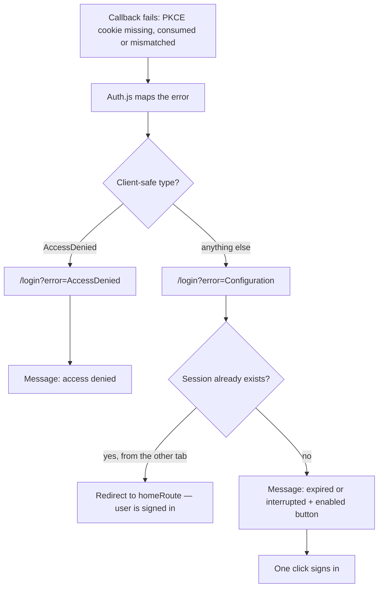

# Design: Recoverable login errors

## GitHub Issue

[#16 — Interrupted or repeated OIDC login ends on Auth.js "Server error" page without a way back](https://github.com/OpenElementsLabs/nextjs-app-layer/issues/16)

Builds on spec [`004-playwright-e2e-harness`](../004-playwright-e2e-harness/design.md) (#17), whose
fixture app, mock IdP and helpers the end-to-end scenarios run on.

## Summary

An interrupted or repeated OIDC login lands the user on Auth.js' built-in error page, which reads
"Server error — There is a problem with the server configuration" and offers no way back. Nothing is
misconfigured: the login attempt is simply no longer valid, and clicking "Log in" once more would
fix it. Users read it as a broken application.

Two things are wrong, and only the second one is a defect:

1. **The flow fails.** The provider uses the default OIDC check `["pkce"]`. Auth.js stores the code
   verifier in `authjs.pkce.code_verifier`, read once, with a 15-minute lifetime. Parallel logins
   overwrite it, a replayed callback finds it consumed, and an expired or cleared cookie is simply
   missing. Failing here is **correct** — it is a security check and stays untouched.
2. **The failure is presented as a server error with no recovery.** `createAppLayerAuth` sets only
   `pages: { signIn: "/login" }`, so everything else falls through to `/api/auth/error`.

This spec fixes the second one: auth errors route back to `/login`, which already knows how to
recover, with a message that says what actually happened and a button that retries.

## Goals

- No login flow ends on `/api/auth/error`.
- After an interrupted login the user is either already signed in or on `/login` with a clear
  message and a working button.
- `AccessDenied` keeps a distinct message, because retrying does not help.
- The login button cannot start two sign-ins in parallel.

## Non-goals

- Changing the OIDC checks, cookie settings or session strategy. No `checks: []`, no longer cookie
  lifetime "as a fix" — that would trade a confusing page for a weakened security check.
- Recovering the failed login transparently by restarting `signIn` automatically. It can loop when
  the IdP keeps failing, so the user clicks once. (#16's own reasoning.)
- Stripping `?error=` from the URL after reading it. #16 marks this optional; it requires lifting the
  message into component state, and a reload of `/login` showing the message again is not harmful.
  See [Open questions](#open-questions).

## Reproduction

Each of these ends on `/api/auth/error?error=Configuration` today:

| Flow | Steps | Server log |
|---|---|---|
| **B — two tabs** | Start the login in two tabs, reach the IdP in both, finish in the first | `invalid_grant: code_verifier does not compute to code_challenge` |
| **C — replayed callback** | After a successful login, open the `/api/auth/callback/oidc?code=…` URL again (reload, back/forward, restored tab) | `InvalidCheck: pkceCodeVerifier value could not be parsed` |
| **D — cookie gone** | The `authjs.pkce.code_verifier` cookie disappears while the user is on the IdP page (>15 min, or cookies cleared), then the form is submitted | `InvalidCheck: pkceCodeVerifier value could not be parsed` |

Checked and **not** affected: a double click on the login button, a stale `authjs.session-token`
cookie, and the back button after a successful login.

D has a realistic variant: with an active IdP session, an old authorize URL redirects straight to the
callback with no user input. This is the LibreWolf case — it deletes cookies on exit but restores
open tabs, so a restored tab arrives without the PKCE cookie.

## Root cause analysis

Verified in `@auth/core` 0.41.0. Only a fixed set of error types is passed to the client as-is:

```js
// @auth/core/errors.js
const clientErrors = new Set([
  "CredentialsSignin", "OAuthAccountNotLinked", "OAuthCallbackError", "AccessDenied",
  "Verification", "MissingCSRF", "AccountNotLinked", "WebAuthnVerificationError",
]);

// @auth/core/index.js
const type = isClientSafeErrorType ? error.type : "Configuration";
const params = new URLSearchParams({ error: type });
const pagePath = config.pages?.[pageKind] ?? `${config.basePath}/${pageKind.toLowerCase()}`;
```

`InvalidCheck` is not in that set, so all three flows collapse to `error=Configuration`, and with no
`pages.error` configured the redirect target is the built-in `/api/auth/error`.

**This shapes the fix.** The issue proposes mapping specific types (`Configuration`,
"`InvalidCheck`-like", unknown) to messages. Enumerating is the wrong shape: which type a given
failure produces is an `@auth/core` implementation detail — #16 observed `Configuration` for flow B
even though `invalid_grant` could plausibly have surfaced as the client-safe `OAuthCallbackError`.
The robust rule is the inverse: **`AccessDenied` is the one special case; everything else is
retryable.** That classification stays correct whichever type Auth.js picks, including types added in
a future version.

## Fix approach

### `src/server/auth.ts`

```ts
pages: { signIn: "/login", error: "/login" },
```

Auth errors then redirect to `/login?error=<type>` instead of the built-in page.

### `src/pages/login/login-client.tsx`

- Select the message from the error type: `AccessDenied` → "access denied"; anything else →
  "expired or interrupted". The existing `login.error` stays as the fallback string.
- Keep the login button directly below the message, so the retry is where the user is looking.
- Disable the button from the first click until navigation starts, via local state. A double click is
  harmless today, but nothing guards it.

Already present and unchanged: `/login` redirects to `homeRoute` when a session exists, which is what
makes flows B and C resolve to "already signed in" rather than an error — the other tab, or the first
callback, created the session.

### `src/translations/{en,de}.ts`

Add `login.errorExpired` and `login.errorAccessDenied`; keep `login.error` as the fallback.

### Flow after the fix



## Test strategy

#16 prescribes red-green discipline, and this spec keeps it: the E2E scenarios for B, C and D are
written **first** and must be shown to fail against the current code, landing on `/api/auth/error`.
That failure is the proof they reproduce the bug. Writing the fix first would forfeit it.

- **Unit** — `createAppLayerAuth` configures `pages.error`; `LoginClient` renders the right message
  for `AccessDenied`, for `Configuration`, for an unknown value and for no error at all; the button
  is disabled after the first click.
- **End-to-end** (`e2e/login-flows.spec.ts`, on the #17 harness) — the six scenarios from the issue,
  in all three browser projects, each asserting `expectNoAuthErrorPage`.

Scenario D is driven by deleting `authjs.pkce.code_verifier` from the browser context, which is also
the honest way to reproduce the LibreWolf case: that browser deletes cookies on exit while restoring
tabs. Note that spec 004 established the hardened profile itself does **not** break the flow, so the
hardening is not what is being tested here — the missing cookie is.

## Measured during implementation

Two findings from driving the real flow through the harness, both of which correct assumptions in
the issue:

**The underlying error is `CallbackRouteError`, not `InvalidCheck`.** The server log shows
`InvalidCheck: pkceCodeVerifier value could not be parsed`, but the `AuthError` subclass Auth.js
raises is `CallbackRouteError`, and neither is in `clientErrors`, so both collapse to
`Configuration`. Had the message mapping enumerated types as the issue proposes, it would have
missed this one. The classification approach is unaffected.

**An IdP `error=access_denied` surfaces as `OAuthCallbackError`, not `AccessDenied`.** The issue
expects the access-denied message for that flow; it does not appear. `AccessDenied` comes from the
`signIn` callback refusing a sign-in, which `createAppLayerAuth` never does — so that branch is
defensive and unit-tested only. `OAuthCallbackError` is client-safe and classified as retryable,
which is the right outcome: declining consent by accident is recoverable.

Noted separately, outside this spec's scope: the authorize URL carries **no `state` parameter** — the
provider runs the PKCE check alone. #16 puts changing the OIDC checks explicitly out of scope, so
this is recorded in `docs/TODO.md` for its own decision rather than altered here.

## Regression risk

**`pages.error` now swallows genuine misconfiguration.** This is the real cost and it should be
stated plainly: a wrong client secret or an unreachable issuer also produces `Configuration`, so an
operator misconfiguring the app will see users told "your login expired, please try again" and
clicking forever, instead of a page naming a server problem. Mitigations: the actual error is still
logged server-side in full — that is exactly why `isClientError` exists, so configuration details are
never shown to end users — and the alternative, keeping the generic page, leaves the far more common
interrupted-login case with no way back. The trade is deliberate, not accidental.

**Behavioural change for consumers.** Apps that set their own `pages.error`, or that customised
`/api/auth/error`, now behave differently. The upgrade guide must say so. No API signature changes,
so nothing breaks at compile time — which is why the guide matters more than usual here.

**The disabled button could strand a user** if navigation never starts (e.g. `signIn` rejects
without redirecting). The guard is therefore scoped to the click that begins navigation; a page load
resets it.

## Release

Ships in the unreleased 0.10.0: a section is added to `docs/releases/upgrade-to-0.10.md` rather than
a new guide. The change needs nothing from consumers beyond awareness.

## Open questions

- Whether to strip `?error=` from the URL after reading it (`router.replace("/login")`). Listed as
  optional in #16 and deliberately skipped here: it requires holding the message in state, and the
  benefit — a reload not re-showing the message — is small. Easy to add later if it bothers anyone.
- Whether `login.errorExpired` should mention that the previous attempt may have succeeded in
  another tab. Accurate for flow B, confusing for D. Currently left out in favour of one clear
  sentence.
